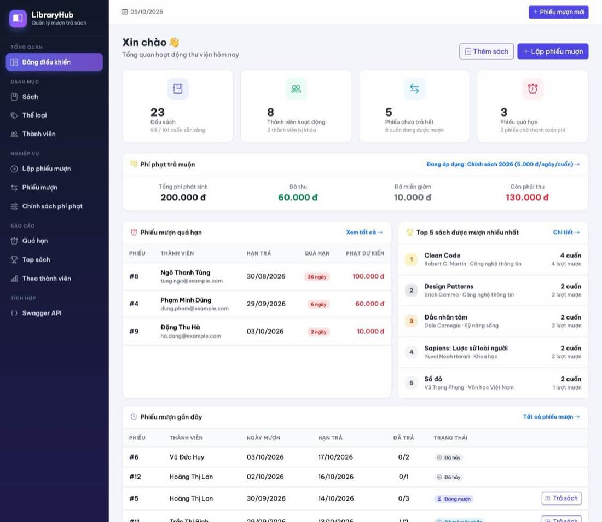
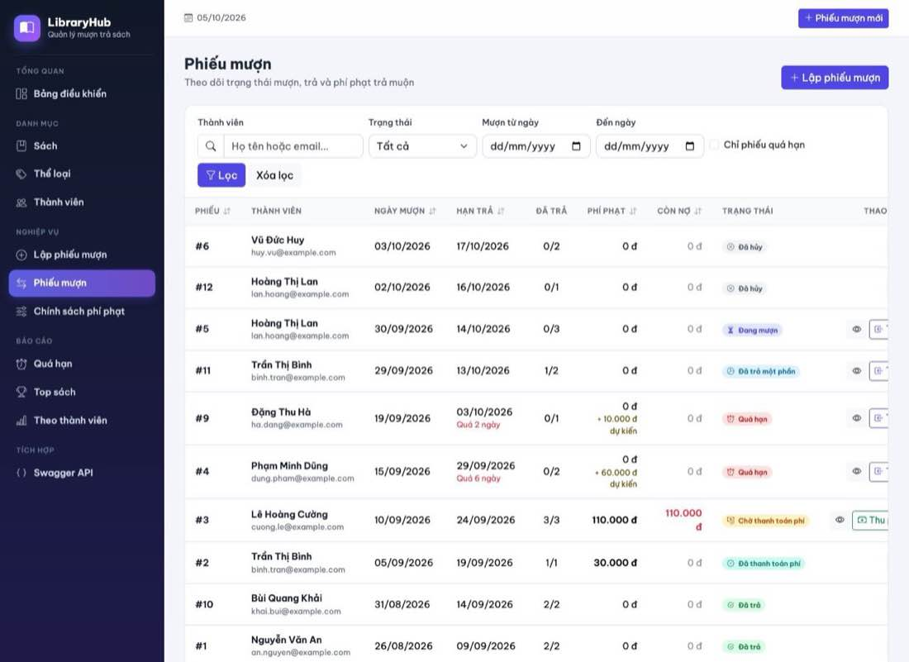
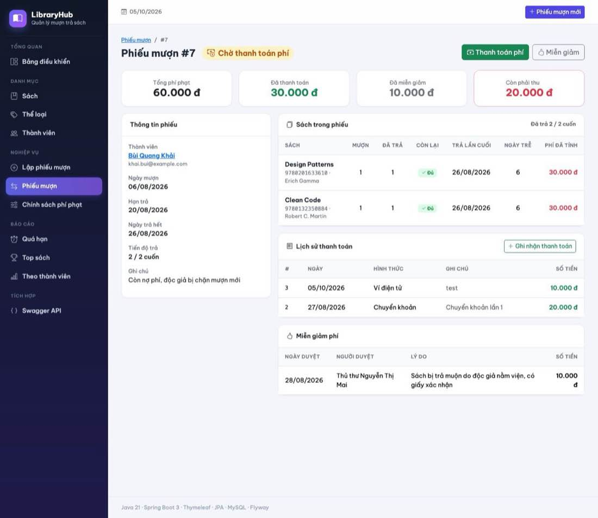
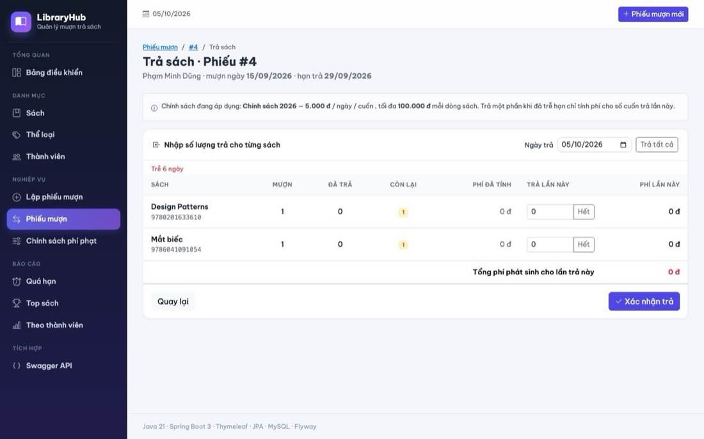
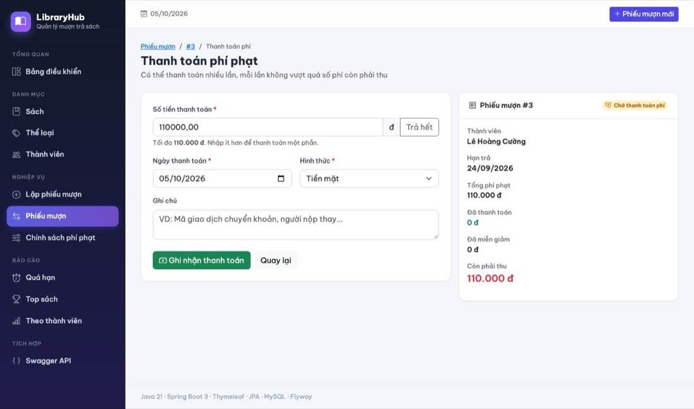
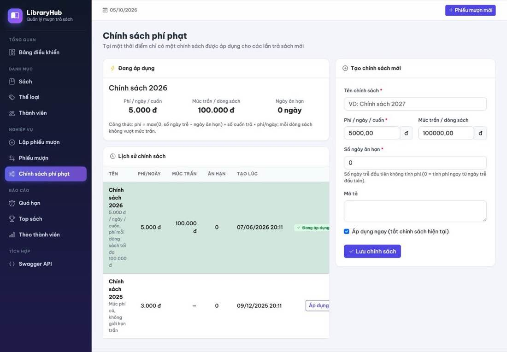
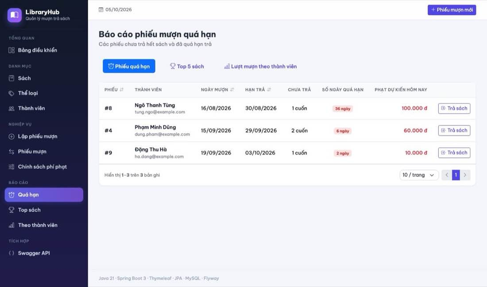
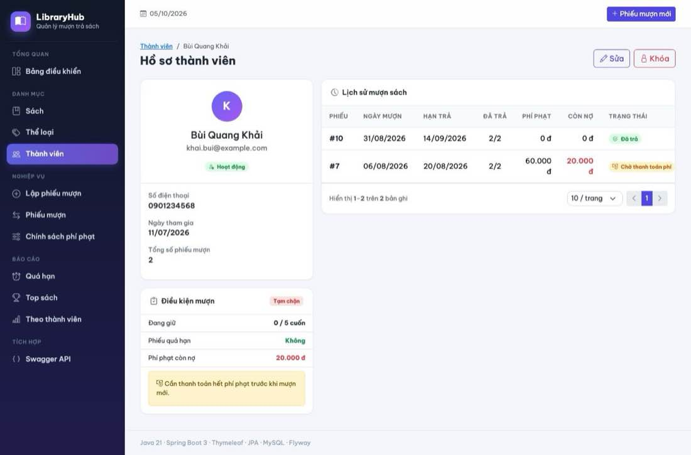
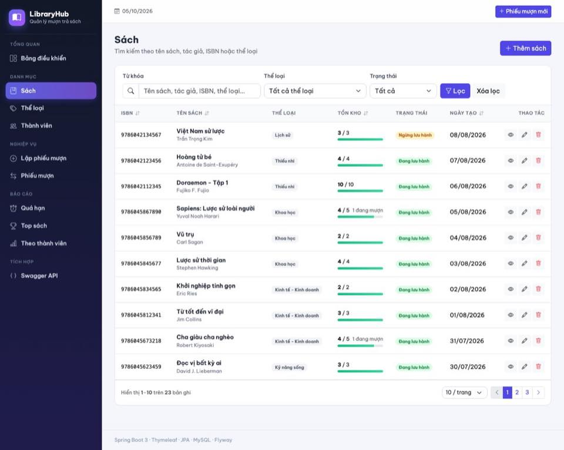
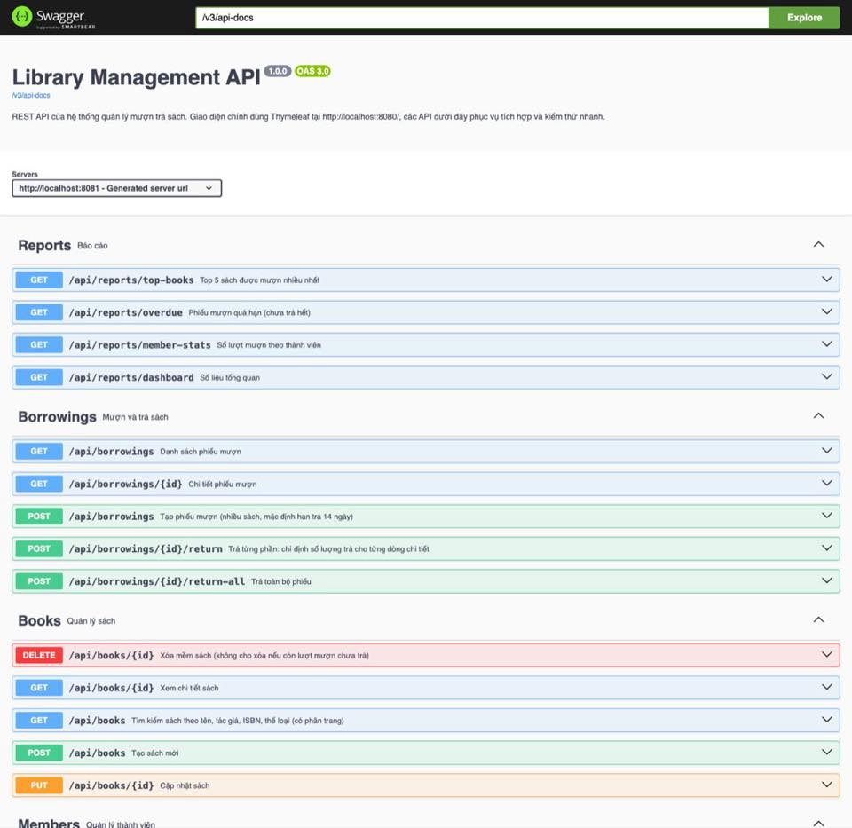

# LibraryHub – Quản lý mượn trả sách và tính phí phạt trả muộn

Bài tập **Spring Boot Thymeleaf nâng cao**: ứng dụng web server-side quản lý sách, độc giả, phiếu mượn nhiều sách,
**trả toàn bộ / trả từng phần**, **tự động tính phí phạt trả muộn** theo chính sách cấu hình được, **thanh toán phí nhiều lần**,
**miễn giảm phí có phê duyệt**, **chặn mượn khi còn nợ** và kiểm soát toàn vẹn dữ liệu bằng **transaction + optimistic locking**.

Giao diện chính là **Thymeleaf + Bootstrap 5**. REST API + Swagger chỉ là phần phụ để kiểm thử nhanh.



## Mục lục

1. [Công nghệ](#1-công-nghệ)
2. [Chạy project](#2-chạy-project)
3. [Cấu hình](#3-cấu-hình)
4. [Database & migration](#4-database--migration)
5. [Trạng thái phiếu mượn](#5-trạng-thái-phiếu-mượn)
6. [Quy tắc nghiệp vụ](#6-quy-tắc-nghiệp-vụ)
7. [Công thức tính phí phạt](#7-công-thức-tính-phí-phạt)
8. [Màn hình Thymeleaf](#8-màn-hình-thymeleaf)
9. [Transaction & concurrency](#9-transaction--concurrency)
10. [Test](#10-test)
11. [REST API (phụ)](#11-rest-api-phụ)
12. [Cấu trúc project](#12-cấu-trúc-project)
13. [Ảnh chụp màn hình](#13-ảnh-chụp-màn-hình)
14. [Trả lời 10 câu hỏi review](#14-trả-lời-10-câu-hỏi-review)

---

## 1. Công nghệ

| Nhóm | Sử dụng |
|------|---------|
| Ngôn ngữ / framework | **Java 21**, Spring Boot 3.3.4, Maven (kèm Maven Wrapper) |
| Web UI | Spring MVC, Thymeleaf 3.1, Bootstrap 5.3, Bootstrap Icons |
| Database | MySQL 8, Spring Data JPA, Hibernate 6 (`ddl-auto: validate`) |
| Validation | Bean Validation (`@Valid`, `@NotBlank`, `@DecimalMin`, `@PastOrPresent`, …) + validator tự viết; lỗi hiển thị ngay dưới ô nhập |
| Migration | Flyway (`V1`…`V4`) |
| Test | JUnit 5, Mockito, AssertJ, **H2** cho integration test (rollback, concurrency) |
| Khác | Lombok, springdoc-openapi (Swagger), Docker / Docker Compose, Scheduled job |

## 2. Chạy project

### Cách 1 – Docker Compose

```bash
cd library-management
docker compose up -d --build
```

- Ứng dụng: <http://localhost:8080>
- MySQL: `localhost:3306`, user `root` / `root`, database `library_db`

### Cách 2 – Maven

Yêu cầu: **JDK 21** và **MySQL 8** đang chạy (không cần cài Maven).

```bash
# macOS / Linux
./mvnw spring-boot:run

# Windows
mvnw.cmd spring-boot:run
```

Mặc định kết nối `localhost:3306`, user `root`, mật khẩu `root`, tự tạo database `library_db`.
Dùng tài khoản khác thì truyền biến môi trường:

```bash
DB_USERNAME=myuser DB_PASSWORD=secret ./mvnw spring-boot:run
```

Mở <http://localhost:8080>. Flyway tự tạo bảng và nạp dữ liệu mẫu ở lần chạy đầu.

### Đóng gói

```bash
./mvnw clean package            # chạy toàn bộ test (unit + integration H2)
java -jar target/library-management-2.0.0.jar
```

## 3. Cấu hình

| Biến môi trường | Mặc định | Ý nghĩa |
|-----------------|----------|---------|
| `DB_URL` | `jdbc:mysql://localhost:3306/library_db?createDatabaseIfNotExist=true&...` | JDBC URL |
| `DB_USERNAME` / `DB_PASSWORD` | `root` / `root` | Tài khoản MySQL |
| `SERVER_PORT` | `8080` | Cổng HTTP |

```yaml
app:
  borrowing:
    default-loan-days: 14       # hạn trả mặc định
    max-books-per-member: 5     # số cuốn chưa trả tối đa / độc giả
    default-fine-per-day: 5000  # chỉ dùng khi chưa có chính sách phí nào active
  overdue-job:
    cron: "0 5 0 * * *"         # 00:05 hằng ngày đánh dấu phiếu quá hạn
```

**Mức phí thật được cấu hình trên giao diện** tại `/fine-policies` (lưu trong bảng `fine_policies`), không cần sửa code.

## 4. Database & migration

| File | Nội dung |
|------|----------|
| `V1__init_schema.sql` | `categories`, `books` (có `version`), `members`, `borrowings`, `borrowing_details`; FK, UNIQUE, CHECK, index |
| `V2__seed_data.sql` | 7 thể loại, 23 sách, 10 độc giả (2 bị khóa), 10 phiếu mượn |
| `V3__fine_management_schema.sql` | Bổ sung nghiệp vụ phí phạt (chi tiết bên dưới) |
| `V4__fine_management_seed.sql` | 2 chính sách phí (1 active), thanh toán / miễn giảm mẫu, phiếu trả một phần, phiếu đã hủy |

**V3 thay đổi gì**

- `borrowings`: `total_fine_amount`, `paid_fine_amount`, `waived_fine_amount`, `unpaid_fine_amount`, `cancelled_date`, `cancel_reason`, `version` (optimistic lock).
  CHECK: trạng thái thuộc 7 giá trị, số tiền không âm, và **cân đối** `paid + waived + unpaid = total`.
- `borrowing_details`: thêm `late_days` (cùng với `quantity`, `returned_quantity`, `last_returned_date`, `fine_amount` đã có).
- `fine_policies`: `daily_fine_amount > 0`, `max_fine_amount >= daily` (nullable), `grace_days >= 0`, `active`.
  **Chỉ một policy active** được đảm bảo ở DB bằng cột sinh `active_marker = CASE WHEN active THEN 1 END` + `UNIQUE`
  (MySQL cho phép nhiều `NULL` trong UNIQUE, nên chỉ đúng một dòng được mang giá trị 1).
- `fine_payments` (`borrowing_id`, `amount > 0`, `payment_date`, `method`, `note`) và `fine_waivers` (`amount > 0`, `reason`, `approved_by`, `approved_date`).
- Index mới: `(member_id, status)`, `borrow_date`, `unpaid_fine_amount`, `fine_payments(borrowing_id)`, `fine_waivers(borrowing_id)`.

```
categories 1──< books 1──< borrowing_details >──1 borrowings >──1 members
                                                   │ 1
                                   ┌───────────────┼───────────────┐
                                   ∨ n             ∨ n
                             fine_payments    fine_waivers         fine_policies (độc lập, 1 active)
```

Dữ liệu mẫu đáng chú ý để thử nhanh:

| Phiếu / độc giả | Tình huống |
|-----------------|------------|
| Phiếu #2 | Đã trả muộn, thanh toán đủ → `FINE_PAID` |
| Phiếu #7 (độc giả #8) | Phí 60.000 đ, đã trả 20.000 đ, miễn giảm 10.000 đ, còn nợ 30.000 đ → `FINE_PENDING`; độc giả #8 bị chặn mượn |
| Phiếu #3, #4, #8, #9 | Quá hạn (`OVERDUE`), trả sẽ phát sinh phí |
| Phiếu #11 | Trả một phần đúng hạn → `PARTIALLY_RETURNED` |
| Phiếu #12 | Đã hủy (`CANCELLED`) |
| Độc giả #9, #10 | Bị khóa |

Muốn làm mới dữ liệu: xóa database `library_db` rồi chạy lại ứng dụng.

## 5. Trạng thái phiếu mượn

Trạng thái **không được set tay rải rác** mà được tính lại từ dữ liệu thật trong `Borrowing.refreshStatus(today)` sau mỗi thao tác:

```
Còn sách chưa trả:   dueDate < hôm nay → OVERDUE
                     đã trả > 0        → PARTIALLY_RETURNED
                     chưa trả cuốn nào → BORROWING
Đã trả hết:          tổng phí = 0      → RETURNED
                     còn nợ > 0        → FINE_PENDING
                     nợ = 0            → FINE_PAID
Hủy (chỉ khi chưa trả cuốn nào và chưa có phí) → CANCELLED (không đổi nữa)
```

## 6. Quy tắc nghiệp vụ

**Mượn sách** – `BorrowingService.createBorrowing` (`@Transactional`)

- Độc giả bị khóa, **đang có phiếu quá hạn** hoặc **còn phí chưa thanh toán** → không được tạo phiếu (thông báo nêu rõ số tiền còn nợ).
- Tối đa **5 cuốn chưa trả** / độc giả (tính cả các phiếu đang mở).
- Ít nhất một dòng sách, **không trùng `bookId`**, số lượng > 0 và ≤ `availableQuantity`, sách phải đang lưu hành.
- Trừ tồn kho từng sách trong cùng transaction; một dòng lỗi → **rollback toàn bộ phiếu**.

**Trả sách** – `returnBooks` (từng phần) / `returnAll` (`@Transactional`)

- Không trả vượt số còn đang mượn, không trả 0 cuốn, ngày trả không ở tương lai và không trước ngày mượn.
- Không cho trả trên phiếu `RETURNED` / `FINE_*` / `CANCELLED`.
- Cộng lại `availableQuantity`, cập nhật `returnedQuantity`, `lastReturnedDate`, `lateDays`, `fineAmount` của dòng và tổng phí của phiếu — tất cả cùng commit hoặc cùng rollback.
- Trả từng phần sau hạn: **chỉ tính phí cho số cuốn trả lần đó**.

**Thanh toán & miễn giảm phí** – `FinePaymentService` (`@Transactional`)

- Thanh toán nhiều lần; mỗi lần > 0 và **không vượt số phí còn phải thu** (kiểm tra ở form, ở entity `Borrowing.addPayment` và CHECK cân đối ở DB).
- Hết nợ → `FINE_PAID`; còn nợ → độc giả bị chặn mượn mới.
- Miễn giảm: bắt buộc **lý do** (≥ 10 ký tự) và **người duyệt**, cũng không vượt số còn nợ.

**Hủy phiếu** – `cancel` (`@Transactional`): chỉ khi chưa trả cuốn nào và chưa phát sinh phí, bắt buộc lý do, hoàn lại toàn bộ tồn kho.

**Chính sách phí** – `FinePolicyService`: không sửa policy cũ mà **tạo phiên bản mới rồi kích hoạt**; kích hoạt policy mới sẽ tắt policy cũ trong cùng transaction.

## 7. Công thức tính phí phạt

Nằm duy nhất trong `FineCalculationService` (hàm thuần, không truy cập DB, dễ test):

```
lateDays        = max(0, actualReturnDate − dueDate)
chargeableDays  = max(0, lateDays − graceDays)
fineAmount      = chargeableDays × returnedQuantity × dailyFineAmount
nếu có maxFineAmount: fineAmount = min(fineAmount, maxFineAmount − phí đã tính trước đó của dòng này)
```

Mức trần áp dụng **theo từng dòng sách, cộng dồn qua các lần trả** (trả từng phần nhiều lần cũng không vượt trần).
Màn hình trả sách dùng cùng công thức bằng JavaScript để **xem trước phí trước khi xác nhận**; số liệu cuối cùng vẫn do server tính.

Bảng ví dụ của đề (phí 5.000 đ/ngày, đã có test tương ứng trong `FineCalculationServiceTest`):

| Tình huống | Hạn trả | Ngày trả | Kết quả |
|------------|---------|----------|---------|
| Trả đúng hạn | 2026-10-10 | 2026-10-10 | lateDays = 0, fine = 0 |
| Trễ 3 ngày, 1 cuốn | 2026-10-10 | 2026-10-13 | 3 × 1 × 5.000 = **15.000 đ** |
| Trễ 3 ngày, 2 cuốn | 2026-10-10 | 2026-10-13 | 3 × 2 × 5.000 = **30.000 đ** |
| graceDays = 1 | 2026-10-10 | 2026-10-12 | trễ 2, tính phí 1 ngày = **5.000 đ** |
| maxFineAmount = 100.000 | 2026-10-01 | 2026-10-30 | 29 × 5.000 = 145.000 → **100.000 đ** |

## 8. Màn hình Thymeleaf

| Màn hình | Route | Chức năng |
|----------|-------|-----------|
| Bảng điều khiển | `GET /` | Thống kê, tổng phí phát sinh / đã thu / miễn giảm / còn phải thu, phiếu quá hạn |
| Danh sách sách | `GET /books` | Tìm kiếm, lọc, phân trang, tồn kho còn mượn được |
| Tạo phiếu mượn | `GET /borrowings/new`, `POST /borrowings` | Chọn độc giả, nhiều sách (thêm / bớt dòng), số lượng, hạn trả; cảnh báo trùng sách và vượt 5 cuốn ngay trên form |
| Danh sách phiếu | `GET /borrowings` | Lọc theo **trạng thái, độc giả, khoảng ngày mượn, chỉ phiếu quá hạn**; cột phí và còn nợ |
| Chi tiết phiếu | `GET /borrowings/{id}` | Thông tin phiếu, từng dòng sách (ngày trễ, phí), **tổng phí / đã thanh toán / miễn giảm / còn phải thu**, lịch sử thanh toán, miễn giảm, hủy phiếu |
| Trả sách | `GET /borrowings/{id}/return`, `POST /borrowings/{id}/return` | Nhập số lượng trả từng sách, **xem trước phí phát sinh** |
| Trả toàn bộ | `POST /borrowings/{id}/return-all` | |
| Hủy phiếu | `POST /borrowings/{id}/cancel` | Bắt buộc lý do |
| Thanh toán phí | `GET /borrowings/{id}/payments/new`, `POST /borrowings/{id}/payments` | Ghi nhận một phần / toàn bộ |
| Miễn giảm phí | `GET /borrowings/{id}/waivers/new`, `POST /borrowings/{id}/waivers` | Lý do + người duyệt |
| Cấu hình phí phạt | `GET /fine-policies`, `POST /fine-policies`, `POST /fine-policies/{id}/activate` | Phí/ngày, graceDays, maxFineAmount, lịch sử chính sách |
| Báo cáo quá hạn | `GET /reports/overdue` | Độc giả quá hạn, số ngày trễ, phí dự kiến hôm nay |
| Hồ sơ độc giả | `GET /members/{id}` | Điều kiện mượn (đang giữ / quá hạn / còn nợ) và lịch sử |

Lỗi Bean Validation hiển thị dưới từng ô; lỗi nghiệp vụ từ service (`BusinessException(field, message)`) được gắn lên đúng ô
hoặc hiển thị đầu form; thao tác thành công chuyển hướng (PRG) kèm thông báo xanh.

## 9. Transaction & concurrency

- `@Transactional` trên **tạo phiếu, trả sách, hủy phiếu, thanh toán, miễn giảm, tạo / kích hoạt policy**; service mặc định `readOnly = true`.
- Controller chỉ nhận form, gọi service, chọn view — **không chứa nghiệp vụ, không dùng `synchronized`**.
- **Optimistic locking** `@Version` trên `Book` (tồn kho) và `Borrowing` (số dư phí, số lượng đã trả).
  Service gọi `saveAndFlush` để phát hiện xung đột ngay trong transaction, đổi thành `ConcurrentUpdateException` (thông báo thân thiện) và rollback.
- Ba lớp chặn tồn kho âm: `Book.decreaseAvailable()` → `@Version` → `CHECK (available_quantity >= 0)`.

## 10. Test

```bash
./mvnw test
```

**59 test**, tất cả chạy không cần MySQL (integration test dùng H2, profile `test`):

| Lớp test | Loại | Nội dung |
|----------|------|----------|
| `FineCalculationServiceTest` | Unit | Bảng ví dụ của đề, graceDays, maxFineAmount (kể cả cộng dồn), số lượng 0 |
| `BorrowingServiceTest` | Unit (Mockito) | Mượn nhiều sách; thiếu tồn kho; trùng sách; phiếu rỗng / số lượng 0; độc giả bị khóa / **còn nợ phí** / có phiếu quá hạn / vượt 5 cuốn; xung đột `@Version`. Trả đủ đúng hạn → `RETURNED`; trả một phần đúng hạn → `PARTIALLY_RETURNED`; **trễ 3 ngày** → 15.000 đ, `lateDays = 3`; **trả từng phần sau hạn chỉ tính phí số cuốn trả**; trả vượt số lượng; phiếu đã trả / đã hủy; ngày trả tương lai. Hủy phiếu và chặn hủy khi đã trả. |
| `FinePaymentServiceTest` | Unit | **Thanh toán một phần**; nhiều lần đến `FINE_PAID`; **thanh toán vượt nợ bị từ chối**; số tiền 0; ngày trước ngày mượn; phiếu hết nợ; miễn giảm và bắt buộc lý do / người duyệt |
| `FinePolicyServiceTest` | Unit | Policy dự phòng, tắt policy cũ trước khi kích hoạt policy mới, mức trần < phí ngày |
| `BorrowingFlowIntegrationTest` | Integration (H2) | **Thiếu tồn kho → rollback toàn bộ** (không sách nào bị trừ); **lỗi ở bước tính phí dòng thứ hai → rollback** cả tồn kho, số lượng đã trả, phí của dòng đầu; luồng trả muộn → bị chặn mượn → trả góp → `FINE_PAID` → mượn lại được; trả từng phần sau hạn |
| `ConcurrentBorrowingIntegrationTest` | Integration (H2) | **Hai thread cùng mượn cuốn cuối cùng → đúng một thành công**, tồn kho = 0 |
| `BookServiceTest`, `MemberServiceTest`, `CategoryServiceTest` | Unit | Nghiệp vụ danh mục của bài cơ bản |

## 11. REST API (phụ)

Swagger UI: <http://localhost:8080/swagger-ui.html>

| Method | Endpoint | Mô tả |
|--------|----------|-------|
| GET | `/api/borrowings?keyword=&memberId=&status=&fromDate=&toDate=&overdueOnly=` | Tìm phiếu |
| GET / POST | `/api/borrowings`, `/api/borrowings/{id}` | Chi tiết, tạo phiếu |
| POST | `/api/borrowings/{id}/return`, `/api/borrowings/{id}/return-all` | Trả sách |
| POST | `/api/borrowings/{id}/cancel` | Hủy phiếu |
| POST | `/api/borrowings/{id}/payments`, `/api/borrowings/{id}/waivers` | Thanh toán / miễn giảm |
| GET… | `/api/books`, `/api/members`, `/api/reports/...` | Danh mục và báo cáo |

Lỗi trả về JSON thống nhất: `400` dữ liệu không hợp lệ (kèm `fieldErrors`), `404` không tìm thấy, `409` trùng dữ liệu, `422` vi phạm nghiệp vụ.

```bash
# Thanh toán vượt số nợ -> 422
curl -X POST http://localhost:8080/api/borrowings/7/payments -H "Content-Type: application/json" \
  -d '{"amount":999999,"paymentDate":"2026-10-05","method":"CASH"}'
```

## 12. Cấu trúc project

```
library-management
├── Dockerfile, docker-compose.yml, pom.xml, mvnw
├── docs/screenshots/
└── src
    ├── main/java/com/example/library
    │   ├── config/            # Clock, OpenAPI, BorrowingProperties
    │   ├── controller/web/    # MVC controller (Borrowing, Fine, FinePolicy, Book, Member, Report…)
    │   ├── controller/api/    # REST controller (phụ)
    │   ├── dto/ dto/form/ dto/report/
    │   ├── entity/ entity/enums/   # Borrowing, BorrowingDetail, FinePolicy, FinePayment, FineWaiver…
    │   ├── exception/         # BusinessException, ConcurrentUpdateException, handler web + API
    │   ├── mapper/            # Entity -> DTO
    │   ├── repository/
    │   ├── scheduler/         # OverdueBorrowingJob
    │   ├── service/           # BorrowingService, FineCalculationService, FinePaymentService, FinePolicyService…
    │   ├── util/ validation/ web/
    ├── main/resources
    │   ├── db/migration/      # V1..V4
    │   └── templates/         # borrowings/*, fine-policies/*, reports/*, …
    └── test
        ├── java/.../service/      # unit test
        ├── java/.../integration/  # integration test H2
        └── resources/application-test.yml
```

## 13. Ảnh chụp màn hình

| | |
|---|---|
|  Bảng điều khiển + tổng hợp phí |  Danh sách phiếu, lọc trạng thái / ngày / quá hạn |
|  Chi tiết phiếu: phí, thanh toán, miễn giảm |  Trả sách, xem trước phí |
|  Thanh toán phí |  Cấu hình chính sách phí |
|  Báo cáo quá hạn |  Độc giả bị chặn mượn do còn nợ |
|  Danh sách sách |  Swagger UI |

## 14. Trả lời 10 câu hỏi review

**1. Vì sao nghiệp vụ trả sách và tính phí phạt phải nằm trong cùng một transaction?**
Một lần trả sách thay đổi nhiều dữ liệu phụ thuộc nhau: `returnedQuantity`, `lastReturnedDate`, `lateDays`, `fineAmount` của
từng dòng, `availableQuantity` của sách, tổng phí / số còn nợ và trạng thái của phiếu. Nếu tách ra, một lỗi giữa chừng
(ví dụ lỗi khi tính phí dòng thứ hai) sẽ để lại trạng thái sai: sách đã cộng lại kho nhưng phí chưa ghi, hoặc độc giả
"trả xong" mà không bị tính phí. Đặt trong một `@Transactional` (`BorrowingService.returnBooks/returnAll`) thì tất cả cùng
commit hoặc cùng rollback; persistence context cũng giữ `@Version` của `Book` / `Borrowing` để phát hiện ghi đè đồng thời.
Test `returnRollsBackWhenFineCalculationFails` chứng minh điều này.

**2. Trả từng phần sau hạn thì phí tính trên toàn bộ phiếu hay trên số lượng trả từng lần? Vì sao?**
Tính **trên số lượng trả từng lần**, tại ngày trả của lần đó. Mỗi cuốn trễ bao nhiêu ngày thì chịu phí bấy nhiêu ngày:
cuốn trả sớm hơn không nên bị phạt theo ngày của cuốn trả muộn hơn, và cuốn chưa trả thì chưa thể biết số ngày trễ.
Tính trên toàn phiếu sẽ phạt trùng (tính lại cả các cuốn đã trả) hoặc phạt thiếu. Vì vậy phí được lưu ở **từng dòng**
(`borrowing_details.fine_amount`) và cộng dồn; phiếu chỉ giữ tổng để hiển thị và đối soát.

**3. Làm thế nào để `availableQuantity` không bị âm khi nhiều người mượn đồng thời?**
- `Book` có `@Version`: hai giao dịch cùng đọc `available = 1, version = 5`; giao dịch commit trước chạy
  `UPDATE … SET available = 0, version = 6 WHERE id = ? AND version = 5`; giao dịch sau cập nhật 0 dòng →
  `OptimisticLockingFailureException` → `ConcurrentUpdateException`, rollback toàn phiếu, người dùng được báo thử lại.
- `Book.decreaseAvailable()` từ chối khi không đủ số lượng (giao dịch đến sau, đọc sau khi giao dịch kia commit, sẽ bị chặn ở đây).
- `CHECK (available_quantity >= 0 AND available_quantity <= total_quantity)` ở DB là chốt chặn cuối.
- Test `ConcurrentBorrowingIntegrationTest` chạy hai thread mượn cuốn cuối: đúng một thành công, tồn kho bằng 0.

**4. Ưu nhược điểm của optimistic locking và pessimistic locking trong bài này?**

| | Optimistic (`@Version`) – đang dùng | Pessimistic (`SELECT … FOR UPDATE`) |
|---|---|---|
| Ưu | Không giữ khóa khi đọc, tốt cho hệ thống ít tranh chấp (thư viện: hiếm khi nhiều người cùng giành một cuốn); không deadlock; áp dụng được cho cả `Book` và `Borrowing` | Giao dịch đến sau chờ rồi chạy tiếp với dữ liệu mới, không phải thử lại; phù hợp khi tranh chấp cao |
| Nhược | Giao dịch thua phải báo lỗi / thử lại; nếu tranh chấp nhiều thì tỉ lệ thất bại cao | Giữ khóa hàng suốt transaction, giảm throughput; dễ deadlock khi khóa nhiều sách theo thứ tự khác nhau (cần sắp xếp `bookId` trước khi khóa); phụ thuộc DB |

Phương án thay thế gọn: câu `UPDATE books SET available = available - :q WHERE id = :id AND available >= :q` và kiểm tra số dòng bị ảnh hưởng.

**5. Vì sao không nên viết công thức tính phí trong controller?**
Controller chỉ là lớp nhận request / chọn view. Công thức phí được dùng ở nhiều nơi: trả sách, xem trước phí ở chi tiết
phiếu, báo cáo quá hạn, danh sách phiếu, REST API. Đặt trong controller sẽ lặp code và dễ lệch nhau (đề bài coi là điều kiện
không đạt). `FineCalculationService` là hàm thuần nhận `dueDate`, ngày trả, số lượng, phí đã tính và `FinePolicy` nên
test độc lập dễ dàng (bảng ví dụ), đổi chính sách không phải sửa controller, và chạy bên trong transaction của service.

**6. Nếu thư viện đổi chính sách phí theo từng loại sách thì cần mở rộng thế nào?**
- DB: thêm `category_id` (nullable) vào `fine_policies` (hoặc bảng `fine_policy_rules(policy_id, category_id, daily, max, grace)`); quy tắc không có category là mặc định.
  Ràng buộc "một active" chuyển thành UNIQUE theo `(category_id, active_marker)`.
- Code: thêm `FinePolicyResolver.resolve(book)` trả về policy phù hợp (theo thể loại, rơi về mặc định). `BorrowingService.returnDetail`
  đã tính phí **theo từng dòng sách**, nên chỉ cần lấy policy theo `detail.getBook()` thay vì một policy chung — công thức trong `FineCalculationService` giữ nguyên.
- Nên lưu `fine_policy_id` lên `borrowing_details` khi tính phí để truy vết chính sách đã áp dụng (policy được versioning, không sửa đè).

**7. Khi nào chuyển trạng thái OVERDUE: scheduler hay tính động khi hiển thị?**
Dùng **cả hai**, mỗi cách cho một mục đích:
- **Tính động** (`dueDate < today` và phiếu còn mở) là nguồn sự thật cho mọi quyết định nghiệp vụ: chặn mượn
  (`existsOverdueByMember`), lọc "chỉ phiếu quá hạn", báo cáo quá hạn, số ngày trễ, phí dự kiến. Nhờ vậy kết quả luôn đúng kể cả khi job chưa chạy.
- **Scheduler** (`OverdueBorrowingJob`, khi khởi động và 00:05 hằng ngày) cập nhật cột `status` để lọc / index theo trạng thái nhanh
  và hiển thị nhất quán. Ngoài ra `refreshStatus(today)` chạy lại sau mỗi lần trả, nên trạng thái được sửa ngay khi có thao tác.

**8. Kiểm thử rollback khi trả sách thành công một phần rồi lỗi ở bước tính phí thế nào?**
Integration test `BorrowingFlowIntegrationTest.returnRollsBackWhenFineCalculationFails` (H2, **không** đặt `@Transactional` trên test
để transaction thật của service commit / rollback):
1. Tạo phiếu quá hạn có 2 dòng sách (tồn kho mỗi sách còn 4/5).
2. `@SpyBean FineCalculationService`: lần gọi đầu chạy thật, lần thứ hai ném `IllegalStateException`.
3. Gọi `returnAll` → dòng 1 đã cộng kho + ghi phí trong bộ nhớ, dòng 2 lỗi.
4. Đọc lại từ DB: `returnedQuantity = 0`, tổng phí = 0, trạng thái vẫn `OVERDUE`, tồn kho cả hai sách vẫn là 4 → chứng minh rollback toàn bộ.

Tương tự, `insufficientStockRollsBackEverything` kiểm tra phiếu nhiều sách mà một sách thiếu thì không sách nào bị trừ kho.

**9. Vì sao cần bảng `FinePayment` thay vì chỉ lưu `paidFineAmount` trên `Borrowing`?**
- Một phiếu được **thanh toán nhiều lần**; mỗi lần cần ngày, hình thức (tiền mặt / chuyển khoản / ví), ghi chú → phải là bảng con.
- **Audit / đối soát**: biết ai trả bao nhiêu, khi nào; tổng thu theo ngày / theo hình thức; một con số cộng dồn không trả lời được.
- Chỉ lưu một số tổng thì sửa nhầm là mất dấu vết; với bảng giao dịch, `paidFineAmount` chỉ là giá trị tổng hợp (cache) có thể tính lại
  và được kiểm tra bằng CHECK `paid + waived + unpaid = total`.
- Tương tự `FineWaiver` tách riêng để lưu lý do, người duyệt — miễn giảm không phải là tiền thu được.

**10. Nếu có một triệu phiếu mượn, cần index và tối ưu truy vấn ở đâu?**
- **Index theo đúng truy vấn nóng** (đã có trong V1 / V3):
  `borrowings(status, due_date)` cho báo cáo quá hạn và job OVERDUE; `borrowings(member_id, status)` cho kiểm tra
  "đang quá hạn / còn nợ / số cuốn đang giữ" khi tạo phiếu; `borrowings(borrow_date)` cho lọc khoảng ngày;
  `borrowing_details(borrowing_id)`, `(book_id)`; `fine_payments(borrowing_id)`. Có thể thêm index một phần / covering `(member_id, unpaid_fine_amount)`.
- **Luôn phân trang** danh sách và báo cáo; dùng `Page` + truy vấn đếm riêng, hoặc keyset pagination (`WHERE id < :lastId`) cho trang sâu.
- **Tổng hợp trong DB** (`SUM`, `COUNT`, `GROUP BY`, `EXISTS`) thay vì nạp entity về Java (đã làm: `sumUnpaidFineByMember`, `existsOverdueByMember`, thống kê).
- Tránh N+1: `@EntityGraph` cho màn hình chi tiết, `default_batch_fetch_size`, projection / DTO cho danh sách; giao dịch đọc `readOnly = true`.
- Lưu số liệu tổng hợp trên phiếu (`total/paid/unpaid`) để không phải `SUM` bảng thanh toán mỗi lần hiển thị.
- Dữ liệu rất lớn: lưu trữ phiếu cũ đã tất toán sang bảng archive / partition theo năm, chạy báo cáo nặng trên read replica, cache dashboard vài phút.
